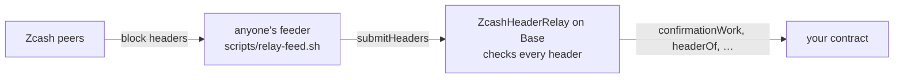

# Seam

A Zcash light client for EVM chains.

A contract on Base checks every Zcash block header against the rules a header has to meet:
- the Equihash (200, 9) solution;
- the difficulty adjustment;
- the time rules;
- the chain with the most work.

This includes NU7's 25-second blocks. Contracts can then read Zcash's best chain on Base without trusting whoever relays
it.



**Status:** v0.1.0. Pre-release, testnets only, not audited.
- **Where it comes from:** extracted on 29 October 2026 from [Zecured](https://github.com/Himess/zecured), my ZECATHON
  2026 entry, with the relay's commit history.
- **What's unchanged:** the relay's Solidity is byte-identical to Zecured at
  [`73de9f9`](https://github.com/Himess/zecured/tree/73de9f909e270e8aea10c2b221905f62a6a4c4df/contracts/src/relay).
- **What's new:** the reader interface, the example, the docs and the deployment below.

## Try it

Two relays on Base Sepolia follow Zcash, one per network:

| | Zcash Testnet | Zcash Mainnet |
|---|---|---|
| Relay | [`0x77ceDADCFf8bE399C67AB579Ad739820FaC5cE0c`](https://sepolia.basescan.org/address/0x77ceDADCFf8bE399C67AB579Ad739820FaC5cE0c#code) | [`0x527B6347d2392d17fa5Bd13DF88A43676501BE48`](https://sepolia.basescan.org/address/0x527B6347d2392d17fa5Bd13DF88A43676501BE48#code) |
| Starts at | block 4,554,953 (`000017d72ff0624af35183aa3d3d4045e79409810fba356c6020a4faecca1036`) | block 3,534,866 (`00000000006de6a6b439a6d0912c7a807253219aa720cf51e84981e40ea67f6b`) |
| Record | [`seam-base-sepolia.relay.json`](contracts/deployments/seam-base-sepolia.relay.json) | [`seam-base-sepolia-mainnet.relay.json`](contracts/deployments/seam-base-sepolia-mainnet.relay.json) |
| Checked | on 29 October 2026 its tip, block 4,555,510, matched CipherScan | on 29 October 2026 its tip, block 3,535,181, matched CipherScan |

Both checkpoints were compared with CipherScan; the Mainnet one also descends from block 3,522,460, the last
checkpoint Zebra 7.0.0 lists. The Mainnet relay is deployed with NU7 at 3,543,405, to cross it when Mainnet activates
NU7, around 6 November 2026.

```sh
cast call 0x77ceDADCFf8bE399C67AB579Ad739820FaC5cE0c "bestChainTip()(bytes32,uint256,uint256)" --rpc-url https://sepolia.base.org
cast call 0x527B6347d2392d17fa5Bd13DF88A43676501BE48 "bestChainTip()(bytes32,uint256,uint256)" --rpc-url https://sepolia.base.org
```

Anyone can feed them, and they check every header, so a feeder can delay a relay but can't make it accept a bad one.
I feed both from a server of mine. If a tip lags, feed it yourself: [docs/RELAYING.md](docs/RELAYING.md).

## Build on it

```solidity
import {IZcashHeaderRelayReader, ZcashNetworks} from "seam/interfaces/IZcashHeaderRelayReader.sol";

IZcashHeaderRelayReader relay = IZcashHeaderRelayReader(0x77ceDADCFf8bE399C67AB579Ad739820FaC5cE0c);
require(relay.networkId() == ZcashNetworks.TESTNET);
// Require work on top of the block, not a block count.
bool isFinal = relay.confirmationWork(blockHash) >= minWork;
```

```sh
forge install Himess/seam@v0.1.0    # remapping: seam/=lib/seam/contracts/src/
```

Where to start:
- [docs/INTEGRATING.md](docs/INTEGRATING.md) covers:
  - byte order;
  - choosing `minWork`;
  - reorganisations;
  - a relay that falls behind;
  - what a header can and can't tell you;
  - shielded payments.
- [`ZcashFinalityGate`](contracts/src/examples/ZcashFinalityGate.sol) is a small example to start from.
- [`abi/`](abi) has the ABI for TypeScript.

**What a contract can read today:**
- Zcash's best chain: block hashes, heights, times and cumulative work.
- Each header's `hashMerkleRoot` and `hashBlockCommitments`. These commit to the block's transactions and to Zcash's
  chain history (ZIP 221), so a zero-knowledge proof about Zcash state can be anchored to a header the relay checked.

**Shielded payments:** a contract can also require that a shielded Ironwood payment went to a receiver it committed
to, for a reference it chose, with no Zcash transaction id, note or address on Base. A RISC Zero proof shows the
payment is in the chain history of a header the relay holds, and `ZcashPaymentVerifier` checks that proof:
- [docs/PAYMENTS.md](docs/PAYMENTS.md) covers what a proof shows, what reaches Base, what you trust, and how to pay and
  prove;
- [`ShieldedPaymentEscrow`](contracts/src/examples/ShieldedPaymentEscrow.sol) is an example: an ERC-20 locked until
  its order's payment is proven;
- the `seam` CLI makes the memo, the witness and the proof.

**One rule:** nothing that links the two chains. Checking a Zcash transaction by its id against `hashMerkleRoot` would
put that id on a public chain; Seam's payment proofs exist to avoid that.

Ideas and open questions are issues labelled [`idea`](https://github.com/Himess/seam/labels/idea). Building on Seam?
Open an issue and say what you need.

## What it checks

For every header:
- the 1,487-byte format, a version of 4 or more, and the link to a known parent;
- the time rules: after the median of the 11 previous blocks, at most 90 minutes after that median, and at most 2 hours
  ahead of Base's clock;
- the nBits the difficulty adjustment requires: a 17-block window at 75 s before NU7, 102 blocks at 25 s from NU7, and
  Testnet's minimum-difficulty rule;
- the Equihash (200, 9) solution, on the EIP-152 BLAKE2b precompile;
- the block hash against the target.

The best chain is the one with the most cumulative work. Details, references and the real data each rule was checked
against are in [contracts/src/relay/README.md](contracts/src/relay/README.md).

## What you have to trust

- **Zcash's proof of work.** Require the work your value at risk needs. On Testnet, never count blocks:
  minimum-difficulty blocks make block counts almost free, and `confirmationWork` doesn't inflate.
- **The deployment input.** That is the checkpoint (a block hash and height, plus the times and nBits of the 113 blocks
  ending with it) and the network's parameters. Compare them with your own node or an explorer: the constructor refuses
  inconsistent parameters, not wrong ones.
- **Someone feeding it.** If nobody does, it falls behind. It never accepts a header that fails a check.
- **Not checked: block contents.** `hashMerkleRoot` and `hashBlockCommitments` are stored as the proof of work commits
  to them. Proving anything about what a block contains takes an inclusion proof.

## Cost

| | |
|---|---|
| Gas per header, whole transaction (mean) | about 626,000 on Testnet after NU7; 579,000 on Mainnet before NU7 |
| Where it goes | Equihash is 361,100 of a typical header's 576,543 gas of execution ([gas table](contracts/src/relay/README.md#gas)) |
| Cheapest batch size | 4 to 8 headers |
| Per day after NU7 | 3,456 headers, about 0.010 ETH at Base mainnet's base fee of 0.005 gwei, measured on a Base mainnet fork ([Zecured's MAINNET.md](https://github.com/Himess/zecured/blob/73de9f909e270e8aea10c2b221905f62a6a4c4df/docs/MAINNET.md#3-a-mainnet-deployment)) |
| The Seam relays on Base Sepolia | Testnet: about 605,000 gas and 0.0000034 ETH per header at 0.005 to 0.006 gwei, about 0.012 ETH a day. Mainnet before NU7: 578,000 gas and 0.0000032 ETH per header, about 0.0037 ETH a day at 75-second blocks. Measured on 29 October 2026 ([RELAYING.md](docs/RELAYING.md#cost)) |

## Zcash Mainnet

[`config/relay-mainnet.json`](contracts/config/relay-mainnet.json) holds Mainnet's rules. They were checked against
1,600 real Mainnet headers, 180 of them in the Solidity tests.

NU7's Mainnet height is 3,543,405, from
[ZIP 259](https://github.com/zcash/zips/blob/2bdf39494320e5e04057ac93b1794031ebfb00b5/zips/zip-0259.md) (status
Proposed) and [Zebra 7.0.0](https://github.com/ZcashFoundation/zebra/releases/tag/v7.0.0). Mainnet was at block
3,535,159 on 29 October 2026, so at 75 s per block NU7 activates there around 6 November. Until then the post-NU7 rules
are checked on Testnet's real headers only (ZIP 218 gives both networks the same ones); tests on real Mainnet headers
across the activation follow it.

## Repository

| Path | What it is |
|---|---|
| `contracts/src/relay/` | **The relay:**<br>• `ZcashHeaderRelay.sol`: the best chain by cumulative work from a checkpoint, with difficulty, time rules, linkage and reorganisations, and NU7's 25-second rules from a height set at deployment<br>• `ZcashEquihash.sol`: Equihash (200, 9) on the EIP-152 BLAKE2b precompile<br>• `ZcashPow.sol`: nBits, work, the difficulty adjustment, the block hash<br>• `IZcashHeaderRelay.sol`: interface, events and errors<br>Details are in its [README](contracts/src/relay/README.md). |
| `contracts/src/interfaces/IZcashHeaderRelayReader.sol` | The read side, for any 0.8 compiler. |
| `contracts/src/examples/ZcashFinalityGate.sol` | Example: act only on a block with enough work on top of it. |
| `contracts/src/payment/` | **Payment proofs:**<br>• `ZcashPaymentVerifier.sol`: checks a proof's seal through the RISC Zero router, for a pinned guest and selector, and its anchor against a Seam relay<br>• `IZcashPaymentVerifier.sol`: its interface and the payment it returns |
| `contracts/src/examples/ShieldedPaymentEscrow.sol` | Example, not audited: an ERC-20 locked until a shielded ZEC payment for the order is proven. |
| `crates/seam-payment` | The statement a payment proof proves, shared by the guest and the hosts, and its K4 catalog: 50 single changes to a payment witness (51 for Mainnet), each with the outcome it must have. |
| `crates/seam-chain` | What a witness needs besides the note's opening, rebuilt from public data: headers from Zcash peers, compact blocks from a light wallet server, the ZIP 221 history tree. Also a disposable wallet's payment. |
| `crates/seam-cli` | `seam`: `memo`, `pay` (Testnet), `witness`; with the `zkvm` feature, `execute`, `prove`, `groth16`, `seal`, `image-id`, `export-elf` and `parity`. |
| `zkvm/` | The payment guest (its own workspace), the crate that embeds it, and the vendored `pasta_curves` with its zkVM patch ([note](zkvm/vendor/pasta_curves/SEAM_PATCH.md)). |
| `contracts/config/` | Each network's consensus parameters, with their sources. |
| `contracts/script/DeployRelay.s.sol` | Deploys a relay from a parameter file and a checkpoint. |
| `contracts/deployments/` | Deployment records: Seam's two relays, and the relay of Zecured's live run on 27 October 2026. |
| `contracts/test/relay/` | **80 tests on real Testnet and Mainnet headers:**<br>• 30 headers across NU7's activation<br>• Equihash checked against the `equihash` crate Zebra uses, on 592 cases<br>• an independent Python implementation of the rules<br>• the P2P header tools |
| `contracts/test/examples/`, `contracts/test/deployments/`, `contracts/test/payment/` | 38 tests of the reader, the examples, the payment verifier and Seam's two deployment records. |
| `scripts/relay-feed.sh` | Feeds a relay from Zcash peers. |
| `abi/` | ABI JSON for TypeScript and other clients. |
| `research/relay-synthetic-headers/` | The solver behind the synthetic test headers (genuine Equihash solutions at Testnet's minimum difficulty). |

## Running the tests

With Foundry 1.8.5:

```sh
git clone --recursive https://github.com/Himess/seam
cd seam/contracts
forge test
```

Three tests need an RPC URL and skip themselves without it:
- the Base mainnet gas measurement (`BASE_MAINNET_RPC_URL`);
- the live checks of the two Seam relays (`BASE_SEPOLIA_RPC_URL`).

The Rust crates, with Rust 1.99.0 (`rust-toolchain.toml`), from the repository's root:

```sh
cargo test
```

This runs the payment statement's K4 catalog natively, on both networks' statements. Three tests that reach Zcash
Testnet peers and a light wallet server are ignored; `crates/seam-chain/tests/network.rs` says how to run them. The
guest builds on Linux or macOS only, with `cargo build -p seam-zkvm-methods`: reproducibly in RISC Zero's Docker
builder with `SEAM_DOCKER_GUESTS=1`, otherwise with the local risc0 toolchain.

**The statement's fixture is synthetic.** `crates/seam-payment/tests/fixtures/TEST-ONLY_testnet_ironwood_tx.json` holds
public chain data only: a real Ironwood-only transaction mined on Zcash Testnet, with its inclusion data. The tests
re-encrypt one of its notes as a payment to a test key and re-anchor it; `crates/seam-payment/src/k4.rs` explains how.

**Mocks.** The payment tests use three, in `contracts/test/payment/Mocks.sol`, each labelled MOCK and refused outside a
local chain (chain id 31337):
- `MockRiscZeroVerifier`, a RISC Zero router that accepts the seal `selector || imageId || journalDigest` and verifies
  no proof;
- `MockToken`, an ERC-20 anyone can mint;
- `MockFeeToken`, an ERC-20 that keeps 1 % of each transfer, which the escrow must refuse.

## Roadmap

1. **Zcash Mainnet across NU7** (v0.2.0): the activation height, tests on real headers across it, and a Base Sepolia
   relay that follows Mainnet.
2. **A standalone relayer:** Zecured's Rust relayer, with lag alarms.
3. **Shielded payment proofs** (v0.3.0):
   - the statement and its RISC Zero guest;
   - reproducible builds;
   - a `ZcashPaymentVerifier`;
   - a prover CLI;
   - an example escrow.
4. **v1.0:** a written spec, an open review round and a draft ZIP.

## Where it comes from

[docs/EXTRACTION_MAP.md](docs/EXTRACTION_MAP.md) lists what came from Zecured, what's still there and when it moves.

## How it was built

Designed by Semih Civelek ([@Himess](https://github.com/Himess)) and built with AI coding assistants. Every claim here
links to a test, a file or a transaction.

## License

MIT
