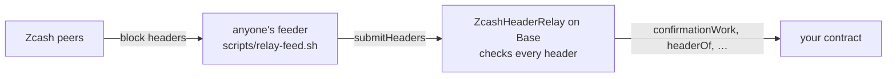

# Seam

A Zcash light client for EVM chains.

A contract on Base checks every Zcash block header against the rules a header has to meet:
- the Equihash (200, 9) solution;
- the difficulty adjustment;
- the time rules;
- the chain with the most work.

This includes NU7's 25-second blocks. Contracts can then read Zcash's best chain on Base without trusting whoever relays
it.



**Status:** v0.1.0. Pre-release, testnets only, not audited.
- **Where it comes from:** extracted on 29 October 2026 from [Zecured](https://github.com/Himess/zecured), my ZECATHON
  2026 entry, with the relay's commit history.
- **What's unchanged:** the relay's Solidity is byte-identical to Zecured at
  [`73de9f9`](https://github.com/Himess/zecured/tree/73de9f909e270e8aea10c2b221905f62a6a4c4df/contracts/src/relay).
- **What's new:** the reader interface, the example, the docs and the deployment below.

## Try it

A relay on Base Sepolia follows Zcash Testnet:

| | |
|---|---|
| Relay | [`0x77ceDADCFf8bE399C67AB579Ad739820FaC5cE0c`](https://sepolia.basescan.org/address/0x77ceDADCFf8bE399C67AB579Ad739820FaC5cE0c#code) |
| Starts at | Zcash Testnet block 4,554,953 (`000017d72ff0624af35183aa3d3d4045e79409810fba356c6020a4faecca1036`), checked against CipherScan |
| Record | [`contracts/deployments/seam-base-sepolia.relay.json`](contracts/deployments/seam-base-sepolia.relay.json) |
| Checked | On 29 October 2026 its tip, block 4,555,510, matched CipherScan |

```sh
cast call 0x77ceDADCFf8bE399C67AB579Ad739820FaC5cE0c "bestChainTip()(bytes32,uint256,uint256)" --rpc-url https://sepolia.base.org
```

Anyone can feed it, and it checks every header, so a feeder can delay it but can't make it accept a bad one.
I feed it from a server of mine. If its tip lags, feed it yourself: [docs/RELAYING.md](docs/RELAYING.md).

## Build on it

```solidity
import {IZcashHeaderRelayReader, ZcashNetworks} from "seam/interfaces/IZcashHeaderRelayReader.sol";

IZcashHeaderRelayReader relay = IZcashHeaderRelayReader(0x77ceDADCFf8bE399C67AB579Ad739820FaC5cE0c);
require(relay.networkId() == ZcashNetworks.TESTNET);
// Require work on top of the block, not a block count.
bool isFinal = relay.confirmationWork(blockHash) >= minWork;
```

```sh
forge install Himess/seam@v0.1.0    # remapping: seam/=lib/seam/contracts/src/
```

Where to start:
- [docs/INTEGRATING.md](docs/INTEGRATING.md) covers:
  - byte order;
  - choosing `minWork`;
  - reorganisations;
  - a relay that falls behind;
  - what a header can and can't tell you.
- [`ZcashFinalityGate`](contracts/src/examples/ZcashFinalityGate.sol) is a small example to start from.
- [`abi/`](abi) has the ABI for TypeScript.

**What a contract can read today:**
- Zcash's best chain: block hashes, heights, times and cumulative work.
- Each header's `hashMerkleRoot` and `hashBlockCommitments`. These commit to the block's transactions and to Zcash's
  chain history (ZIP 221), so a zero-knowledge proof about Zcash state can be anchored to a header the relay checked.

**Next:** proofs that a shielded Ironwood payment went to a committed receiver, checked against this relay, with no
Zcash transaction id, note or address on Base. They work in Zecured today and move here next.

**One rule:** nothing that links the two chains. Checking a Zcash transaction by its id against `hashMerkleRoot` would
put that id on a public chain; Seam's payment proofs exist to avoid that.

Ideas and open questions are issues labelled [`idea`](https://github.com/Himess/seam/labels/idea). Building on Seam?
Open an issue and say what you need.

## What it checks

For every header:
- the 1,487-byte format, a version of 4 or more, and the link to a known parent;
- the time rules: after the median of the 11 previous blocks, at most 90 minutes after that median, and at most 2 hours
  ahead of Base's clock;
- the nBits the difficulty adjustment requires: a 17-block window at 75 s before NU7, 102 blocks at 25 s from NU7, and
  Testnet's minimum-difficulty rule;
- the Equihash (200, 9) solution, on the EIP-152 BLAKE2b precompile;
- the block hash against the target.

The best chain is the one with the most cumulative work. Details, references and the real data each rule was checked
against are in [contracts/src/relay/README.md](contracts/src/relay/README.md).

## What you have to trust

- **Zcash's proof of work.** Require the work your value at risk needs. On Testnet, never count blocks:
  minimum-difficulty blocks make block counts almost free, and `confirmationWork` doesn't inflate.
- **The deployment input.** That is the checkpoint (a block hash and height, plus the times and nBits of the 113 blocks
  ending with it) and the network's parameters. Compare them with your own node or an explorer: the constructor refuses
  inconsistent parameters, not wrong ones.
- **Someone feeding it.** If nobody does, it falls behind. It never accepts a header that fails a check.
- **Not checked: block contents.** `hashMerkleRoot` and `hashBlockCommitments` are stored as the proof of work commits
  to them. Proving anything about what a block contains takes an inclusion proof.

## Cost

| | |
|---|---|
| Gas per header, whole transaction (mean) | about 626,000 on Testnet after NU7; 579,000 on Mainnet before NU7 |
| Where it goes | Equihash is 361,100 of a typical header's 576,543 gas of execution ([gas table](contracts/src/relay/README.md#gas)) |
| Cheapest batch size | 4 to 8 headers |
| Per day after NU7 | 3,456 headers, about 0.010 ETH at Base mainnet's base fee of 0.005 gwei, measured on a Base mainnet fork ([Zecured's MAINNET.md](https://github.com/Himess/zecured/blob/73de9f909e270e8aea10c2b221905f62a6a4c4df/docs/MAINNET.md#3-a-mainnet-deployment)) |
| The Seam relay on Base Sepolia | About 605,000 gas and 0.0000034 ETH per header at 0.005 to 0.006 gwei: about 0.012 ETH a day, measured on 29 October 2026 over 572 headers ([RELAYING.md](docs/RELAYING.md#cost)) |

## Zcash Mainnet

[`config/relay-mainnet.json`](contracts/config/relay-mainnet.json) holds Mainnet's rules. They were checked against
1,600 real Mainnet headers, 180 of them in the Solidity tests.

NU7's Mainnet height is 3,543,405, from
[ZIP 259](https://github.com/zcash/zips/blob/2bdf39494320e5e04057ac93b1794031ebfb00b5/zips/zip-0259.md) (status
Proposed) and [Zebra 7.0.0](https://github.com/ZcashFoundation/zebra/releases/tag/v7.0.0). Mainnet was at block
3,535,159 on 29 October 2026, so at 75 s per block NU7 activates there around 6 November. Until then the post-NU7 rules
are checked on Testnet's real headers only (ZIP 218 gives both networks the same ones); tests on real Mainnet headers
across the activation follow it.

## Repository

| Path | What it is |
|---|---|
| `contracts/src/relay/` | **The relay:**<br>• `ZcashHeaderRelay.sol`: the best chain by cumulative work from a checkpoint, with difficulty, time rules, linkage and reorganisations, and NU7's 25-second rules from a height set at deployment<br>• `ZcashEquihash.sol`: Equihash (200, 9) on the EIP-152 BLAKE2b precompile<br>• `ZcashPow.sol`: nBits, work, the difficulty adjustment, the block hash<br>• `IZcashHeaderRelay.sol`: interface, events and errors<br>Details are in its [README](contracts/src/relay/README.md). |
| `contracts/src/interfaces/IZcashHeaderRelayReader.sol` | The read side, for any 0.8 compiler. |
| `contracts/src/examples/ZcashFinalityGate.sol` | Example: act only on a block with enough work on top of it. |
| `contracts/config/` | Each network's consensus parameters, with their sources. |
| `contracts/script/DeployRelay.s.sol` | Deploys a relay from a parameter file and a checkpoint. |
| `contracts/deployments/` | Deployment records: Seam's relay, and the relay of Zecured's live run on 27 October 2026. |
| `contracts/test/relay/` | **80 tests on real Testnet and Mainnet headers:**<br>• 30 headers across NU7's activation<br>• Equihash checked against the `equihash` crate Zebra uses, on 592 cases<br>• an independent Python implementation of the rules<br>• the P2P header tools |
| `contracts/test/examples/`, `contracts/test/deployments/` | 12 tests of the reader, the example and Seam's deployment record. |
| `scripts/relay-feed.sh` | Feeds a relay from Zcash peers. |
| `abi/` | ABI JSON for TypeScript and other clients. |
| `research/relay-synthetic-headers/` | The solver behind the synthetic test headers (genuine Equihash solutions at Testnet's minimum difficulty). |

## Running the tests

With Foundry 1.8.5:

```sh
git clone --recursive https://github.com/Himess/seam
cd seam/contracts
forge test
```

Two tests need an RPC URL and skip themselves without it:
- the Base mainnet gas measurement (`BASE_MAINNET_RPC_URL`);
- the live check of the Seam relay (`BASE_SEPOLIA_RPC_URL`).

## Roadmap

1. **Zcash Mainnet across NU7:** the activation height, tests on real headers across it, and a Base Sepolia relay that
   follows Mainnet.
2. **A standalone relayer:** Zecured's Rust relayer and P2P client, with lag alarms.
3. **Shielded payment proofs:**
   - the statement and its RISC Zero guest;
   - reproducible builds;
   - a `ZcashPaymentVerifier`;
   - a prover CLI;
   - an example escrow.
4. **v1.0:** a written spec, an open review round and a draft ZIP.

## Where it comes from

[docs/EXTRACTION_MAP.md](docs/EXTRACTION_MAP.md) lists what came from Zecured, what's still there and when it moves.

## How it was built

Designed by Semih Civelek ([@Himess](https://github.com/Himess)) and built with AI coding assistants. Every claim here
links to a test, a file or a transaction.

## License

MIT
